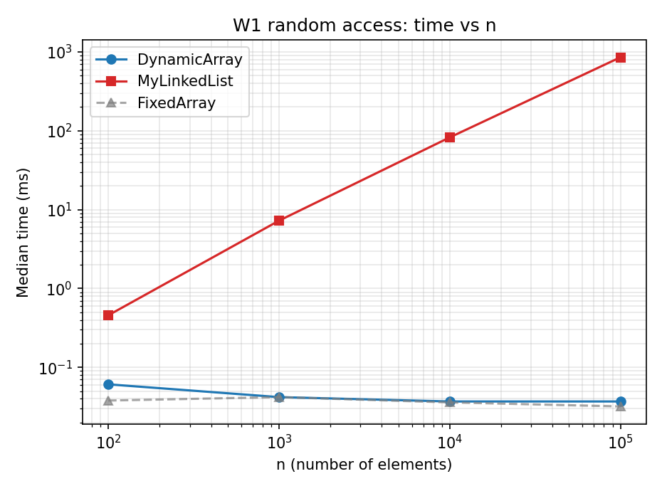
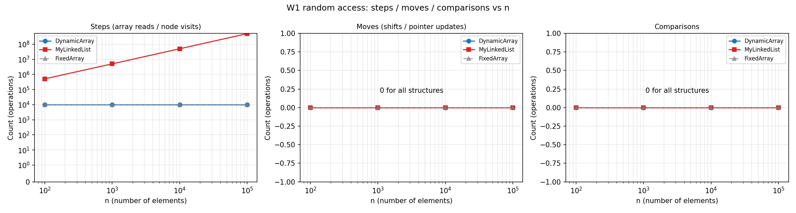
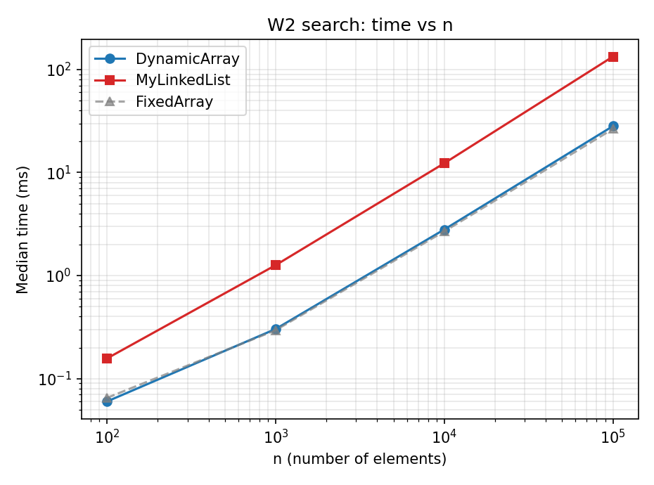
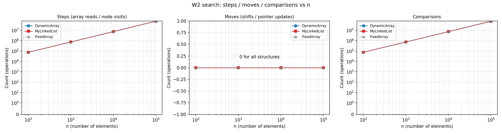
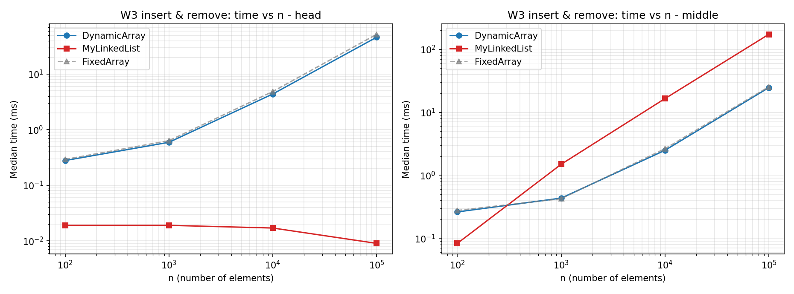
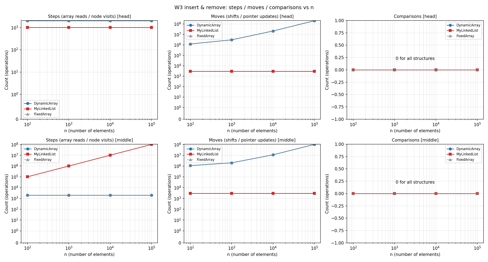
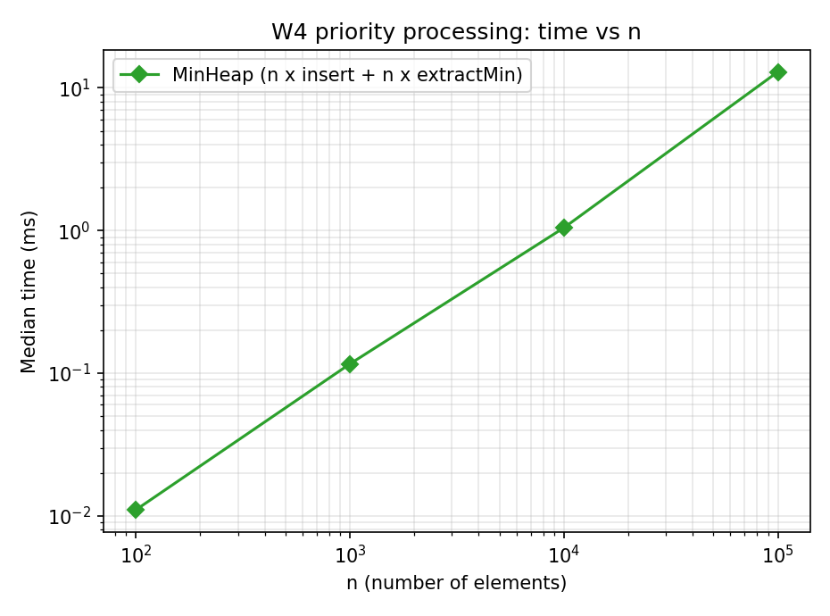
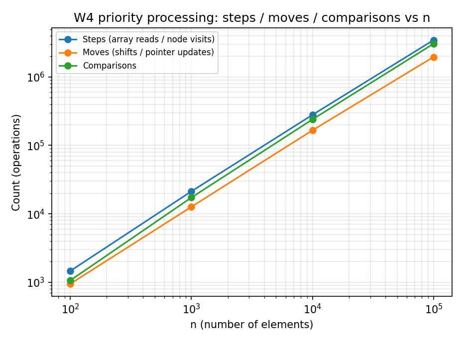
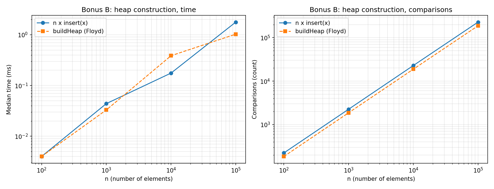

# DAA Assignment 2 - Data Structures: In-Memory Workload Engine

**Student:** Zhibek Serikbekkyzy, SE-2523  |  **Repository:** `<link to GitHub>` (branch `main`, tag `v1.0`)

All structures store primitive `int` values, are written from scratch (no `java.util` collections in `src/main`),
and count their physical operations *inside* the methods:
`steps` = one array-cell read / one list-node visit, `moves` = one element shifted or copied in an array / one pointer
update in the list, `comparisons` = one comparison of two elements. Times are the **median of 5 runs** after 3 discarded
warm-up runs, data comes from `new Random(42)`.

## 1. Complexity table

`n` = number of elements, `h` = log n. Θ is used where the bound is tight, O / Ω where it is not.
Auxiliary space is the extra memory of one call (not counting the structure itself).

| Structure | Operation | Best | Average | Worst | Aux. space | Justification |
|---|---|---|---|---|---|---|
| DynamicArray | `add(x)` | Θ(1) | Θ(1) amortized | Θ(n) | O(1) (Θ(n) in a resize) | write at the end; when full, copy n elements, but doubling makes the cost per add constant on average |
| DynamicArray | `add(index, x)` | Ω(1) | Θ(n) | Θ(n) | O(1) | index = size needs no shift; on average n/2 elements are shifted right |
| DynamicArray | `remove(index)` | Ω(1) | Θ(n) | Θ(n) | O(1) | removing the last element shifts nothing; head shifts n-1 elements |
| DynamicArray | `get(index)` | Θ(1) | Θ(1) | Θ(1) | O(1) | one array access |
| DynamicArray | `contains(x)` | Ω(1) | Θ(n) | Θ(n) | O(1) | x at position 0 vs. a full scan when x is absent |
| MyLinkedList | `add(x)` | Θ(1) | Θ(1) | Θ(1) | O(1) | tail pointer, 2 pointer updates |
| MyLinkedList | `add(index, x)` | Ω(1) | Θ(n) | Θ(n) | O(1) | head/tail are O(1); a middle index needs index-1 node visits |
| MyLinkedList | `remove(index)` | Ω(1) | Θ(n) | Θ(n) | O(1) | head is O(1); any other index needs the predecessor (singly linked), even the last one |
| MyLinkedList | `get(index)` | Ω(1) | Θ(n) | Θ(n) | O(1) | walk from head, index+1 visits |
| MyLinkedList | `contains(x)` | Ω(1) | Θ(n) | Θ(n) | O(1) | linear scan |
| MinHeap | `insert(x)` | Ω(1) | Θ(1) (random data) | Θ(log n) | O(1) (Θ(n) in a resize) | bubble-up stops at once if x >= parent; a new minimum climbs h levels |
| MinHeap | `peekMin()` | Θ(1) | Θ(1) | Θ(1) | O(1) | reads `a[0]` |
| MinHeap | `extractMin()` | Ω(1) (all equal) | Θ(log n) | Θ(log n) | O(1) | the last element put at the root almost always sinks to the bottom: h levels, 2 comparisons per level |
| MinHeap | `buildHeap(a)` (bonus B) | Θ(n) | Θ(n) | Θ(n) | Θ(n) copy | Floyd: sum of node heights is < n, so bottom-up sift-down is linear |

## 2. Loop invariant proofs

### 2.1 `DynamicArray.contains(x)`

```java
for (int i = 0; i < size; i++) {
    if (data[i] == x) return true;
}
return false;
```

* **Invariant:** before every check of the loop condition, with counter `i` (0 <= i <= size), the value `x` does not occur in `data[0..i-1]`.
* **Initialization:** at the first check `i = 0`, the range `data[0..-1]` is empty, so the statement is true.
* **Maintenance:** assume the invariant holds before an iteration with `i < size`. If `data[i] == x` the method returns and there is no next iteration. Otherwise `data[i] != x`, so `x` is not in `data[0..i-1]` and not at `i`, i.e. not in `data[0..(i+1)-1]`: the invariant holds for `i+1`.
* **Termination:** the loop ends either by `return true` (then `data[i] == x`, so `x` is in the array) or because `i == size`. `size - i` decreases by 1 every iteration and is bounded below by 0, so the loop always ends. In the second case the invariant says `x` is not in `data[0..size-1]`, which is the whole content.
* **Conclusion:** `true` is returned only when an equal element was found, and `false` only when the invariant proved that no element equals `x`; therefore `contains` is correct.

### 2.2 `MinHeap.siftDown(i0)` (bubble-down)

Precondition: the subtrees of both children of `i0` are heaps (`a[parent] <= a[child]`); `x = a[i0]` is the value being sunk. The code keeps `x` in a local variable and treats position `i` as a "hole" that moves down.

* **Invariant:** before every iteration, with hole at position `i` (in the subtree of `i0`):
  1. `a[parent] <= a[child]` holds for every parent-child pair in the subtree of `i0` whose parent is **not** `i`;
  2. if `i != i0`, then `a[parent(i)] <= a[c]` for each child `c` of `i`, and `a[parent(i)] < x`.
* **Initialization:** `i = i0`. (1) Pairs with parent `i0` are excluded, all other pairs lie inside the two child subtrees, which are heaps by the precondition. (2) `i == i0`, so nothing is claimed.
* **Maintenance:** in an iteration with children of `i`, let `s` be the smaller child. If `x <= a[s]` the loop stops. Otherwise `a[i] = a[s]` and the hole moves to `s`. (1) The pair (`i`, sibling of `s`) holds because `a[s]` is the smaller child; the pair (`i`, `s`) holds trivially (equal values); pairs below `s` are inside the old heap subtree of `s`, and pairs with parent `s` are excluded now. (2) `a[parent(s)] = a[s]` (old) <= both children of `s`, since the subtree of `s` was a heap, and `a[s] < x` because we moved only when `x > a[s]`.
* **Termination:** `i` grows to a child index (> i) in every iteration and is bounded by `size`, so the loop ends after at most log n iterations, when `i` has no children or `x <= a[smallest child]`.
* **Conclusion:** after the loop `a[i] = x` is written. `x` is <= its children (loop exit condition or no children), `x >= a[parent(i)]` by (2), and all other pairs are correct by (1). So the whole subtree of `i0` is a heap again and `extractMin`/`buildHeap` keep the heap property.

## 3. Results (all raw numbers are in `results/results.csv`)

Median time in ms for n = 100 000 (from the CSV; steps/moves are exact counters):

| Workload | DynamicArray | MyLinkedList | Counters at n = 100 000 |
|---|---|---|---|
| W1 random access, 10 000 `get` | 0.037 | 854.4 | array 10 000 steps; list 500 205 159 steps |
| W2 search, 1 000 `contains` | 28.2 | 133.5 | both 75 381 958 steps and comparisons |
| W3 head, 1 000 add + 1 000 remove | 46.3 | 0.009 | array 200 999 000 moves; list 3 000 moves |
| W3 middle | 24.7 | 173.2 | array 100 999 000 moves; list 100 001 000 steps |
| W4 MinHeap, n insert + n extractMin | 12.96 (MinHeap) | - | 3 460 038 steps, 1 960 267 moves, 3 060 040 comparisons |

(`FixedArray` is a non-growing baseline and behaves like DynamicArray in every workload.)

### Plots (`results/plots/`)

| Workload | Time vs n | Steps / moves / comparisons vs n |
|---|---|---|
| W1 |  |  |
| W2 |  |  |
| W3 |  |  |
| W4 |  |  |

Bonus B: 

## 4. Discussion

**Why DynamicArray is faster for `get(i)` and for iteration.** (1) `get(i)` costs exactly one step in DynamicArray (10 000 steps for every n) but on average about i steps in MyLinkedList (500 205 159 steps at n = 100 000, 50 000 times more), and the measured time differs by a similar factor: 0.037 ms against 854 ms. (2) The array time stays flat as n grows because the address is just base + 4·i, while the list time grows linearly (0.46 ms at n = 100, 854 ms at n = 100 000). (3) Even a simple scan is faster in the array: in W2 both structures make exactly the same 75 381 958 steps and comparisons at n = 100 000, yet the array needs 28 ms and the list 133 ms, about 4.7 times more. (4) The reason is CPU cache locality: ints lie next to each other, so one 64-byte cache line delivers 16 elements and the hardware prefetcher recognizes the sequential pattern.

**Why the list is slower with the same number of steps.** (5) A list node is a separate object with a header, the `int` and the `next` reference (about 24 bytes instead of 4), so a cache line holds only 2-3 nodes and the working set is several times bigger. (6) Pointer chasing makes every load depend on the previous one, because the address of the next node is known only after the current node is read, so the CPU cannot overlap the memory accesses. (7) The garbage collector must also trace and possibly move every node, and my benchmark builds the list in one pass, so the nodes are almost contiguous; a list built by random inserts and removals would be even worse than measured. (8) The same effect appears in W3-middle: array shifts (100 999 000 moves) and list walking (100 001 000 steps) have the same Θ(n) size, but the array takes 24.7 ms and the list 173 ms, about 7 times more.

**When MyLinkedList or MinHeap is the better choice.** (9) MyLinkedList wins when work happens at the head: in W3-head it makes only 3 000 pointer updates instead of about 201 million shifts and takes 0.009 ms against 46 ms, and its cost does not depend on n; it also has no resize pauses, so it fits queues, stacks and LRU-like structures. (10) MinHeap is the right choice when the smallest element is requested repeatedly between inserts (priority scheduling): W4 makes n inserts and n `extractMin` in O(n log n), and the time grows by 12.4 times from n = 10 000 to n = 100 000, which matches n log n, whereas an array or list needs O(n) per minimum. (11) Bonus B: `buildHeap` needs 188 053 comparisons for n = 100 000 against 228 298 for n separate inserts and is faster (1.03 ms against 1.78 ms); the gap is small because random data makes an average insert O(1), and the worst case for inserts (descending input) is Θ(n log n) against Θ(n) for Floyd; at n = 10 000 the time is the other way round (0.39 against 0.18 ms), which is noise at sub-millisecond scale, so the comparison counts are the reliable evidence. (12) A heap is a poor choice for `contains` or index access (Θ(n)), and DynamicArray remains the default when reading by index or scanning dominates.

*Note on measurement:* the counters are incremented inside every method, which adds a small constant cost to every operation for both structures; absolute times are therefore slightly higher than for a version without counters, but the comparison between structures stays fair.
